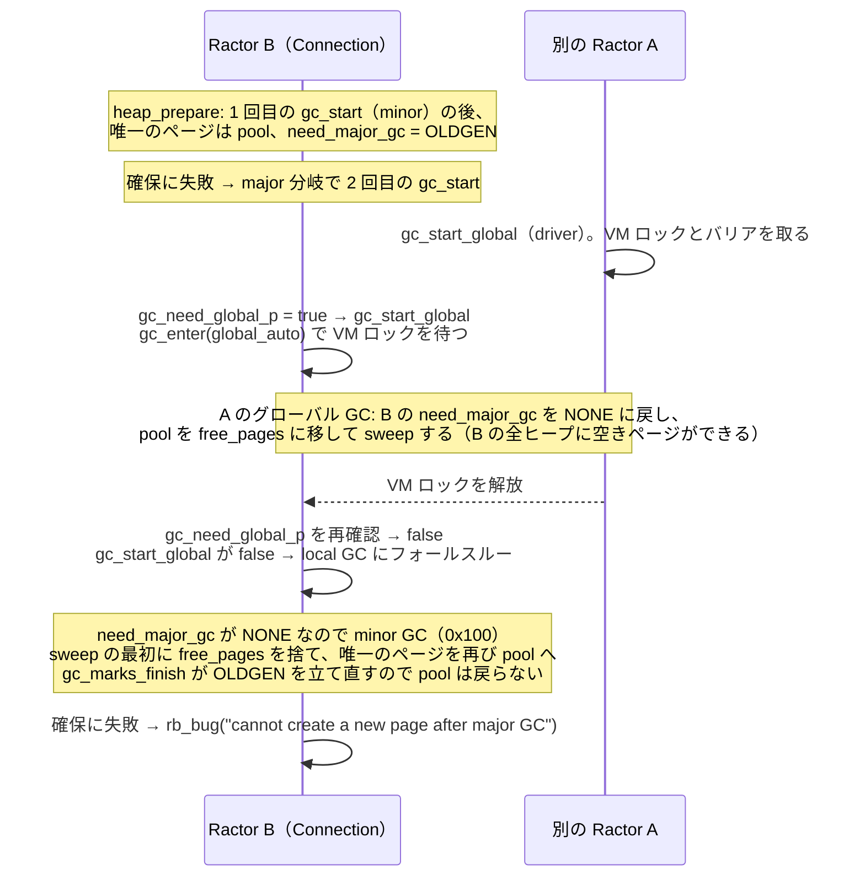

# 4.1.0-preview1 で biryani が `[BUG] cannot create a new page after major GC` で落ちる

Ruby 4.1.0-preview1（`2d08b5f42f`）で biryani に `h2load -n10000 -c50 -m100 -t10`（`bundle exec rake load`）をかけると、
ときどきプロセスが GC のページ確保（[`heap_prepare`](https://github.com/ruby/ruby/blob/2d08b5f42f2cbed4a4e6ecf8d62987a4f21f98c1/gc/default/default.c#L3120-L3183)）の `rb_bug` で落ちる。
4 GB の VM で 10 回中 2 回、8 GiB の VM でも起きた。メモリ不足ではない。

**原因の経路を特定した（2026-11-09）**。`heap_prepare` は、空きスロットの入ったページが pool（`pooled_pages`）に置かれたままのときに「major GC をすれば pool が空く」と見て 2 回目の `gc_start` を呼ぶ。
ところが、この `gc_start` がグローバル GC に進もうとして VM ロックを待つ間に、**別の Ractor のグローバル GC が先に走ると、major GC の要求（`need_major_gc`）が消され、代わりに minor GC が走る**。
minor GC は、グローバル GC が作ったばかりの空きページのリストを捨てて、1 ページしかないヒープのページをまた pool に戻す。そのため確保できず `rb_bug` になる。
計装ビルドで biryani を 20 回流すと 5 回落ち、この重なりが起きた 7 回はすべてクラッシュになった。重なりがなかった major 分岐（1,064 回）はすべて成功した。
上流には、同じ最終状態を `GC.stress` で起こす PR [ruby/ruby#19734](https://github.com/ruby/ruby/pull/19734)（未マージ）がある。この PR の変更を入れると、biryani の経路でも落ちなくなった（20 回中 0 回）。

## 詳細

### 再現条件

- Lima VM（aarch64、4 CPU、4 GB → 8 GiB）、`load/server_spec.rb`（`bundle exec rake load`）
- 1 プロセスで biryani サーバーを起動し、`h2load -n10000 -c50 -m100 -t10` を 1 回流す（同時 Ractor は最大で約 5,100 個）
- 4.1.0-preview1、VM 4 GB、biryani main `7359e96`: 10 回中 2 回（1 回目と 10 回目）落ちた。落ちた回の h2load は、それぞれ 12 件と 2,378 件が失敗した
- 4.1.0-preview1、VM 8 GiB（2026-11-03 にメモリを増やした後）: 8 回目で落ちた（h2load は 177 件失敗）。別の 25 回の試行では 25 回目で落ちた（このときコアダンプを取った）
- どの回も `dmesg` に OOM killer の記録はない。8 GiB の VM では、落ちた後も空きメモリは 7 GB 以上あった
- 4.0.5（per-Ractor GC がない）では、8 GiB の VM で 10 回実行して一度も落ちなかった
- 上流 master の先頭（`2cd57fe63d`、2026-11-08）でも、`heap_prepare`・`gc_start` のフォールスルー・`gc_enter` の `global_auto` は preview1 と同じコードである（実行はしていない）

### クラッシュレポート（抜粋）

```
/biryani-benchmarks/raw/biryani/lib/biryani/streams_context.rb:82: [BUG] cannot create a new page after major GC
ruby 4.1.0preview1 (2026-10-11 master 2d08b5f42f) +PRISM [aarch64-linux]

-- Ruby level backtrace information ----------------------------------------
.../server.rb:15:in 'block (2 levels) in run'
.../connection.rb:51:in 'serve'
.../connection.rb:93:in 'select_loop'
.../connection.rb:261:in 'handle_response'
.../connection.rb:339:in 'send_data'
.../streams_context.rb:82:in 'sendable_datas'

-- Threading information ---------------------------------------------------
Total ractor count: 1351

-- C level backtrace information -------------------------------------------
rb_bug                       error.c:1152
heap_prepare                 gc/default/default.c:3174
heap_next_free_page          gc/default/default.c:3361
newobj_refill                gc/default/default.c:3513
rb_gc_impl_new_obj           gc/default/default.c:3618
rb_ec_newobj_of              gc.c:1250
rb_reg_s_alloc               re.c:3582     ← /.{1,#{max_frame_size}}/m（式展開を含む正規表現リテラル、toregexp）
vm_exec_core                 insns.def:431
thread_do_start_proc         thread.c:641  ← Connection Ractor
```

Connection Ractor が、レスポンスを送るときに Regexp を 1 つ確保しようとして落ちている。どの回もバックトレースは同じだった。
11-09 に計装ビルドで落ちた 5 回も、同じ正規表現リテラルの `rb_reg_s_alloc` で落ちた（biryani v0.0.16 では行番号が `streams_context.rb:87` に変わっている）。
Regexp は slot 512 のヒープに入り、Connection Ractor の objspace ではこのヒープが 1 ページしかない（下のコアダンプ）。そのため、このヒープが最初に詰まりやすい。

### コアダンプで見た状態（2026-11-03、8 GiB の VM、25 回中 25 回目）

落ちた objspace（Connection Ractor のもの）の状態:

| 項目 | 値 | 意味 |
|------|----|------|
| `profile.count` | 4（minor 3、major 1、自分が driver のグローバル GC 0） | 若い objspace |
| `profile.latest_gc_info` | `0x100` | `GPR_FLAG_NEWOBJ` だけ。**最後の GC は minor** |
| `rgengc.need_major_gc` | `0x2` | `GPR_FLAG_MAJOR_BY_OLDGEN`。次は major GC の予定 |
| `rgengc.old_objects` / `old_objects_limit` | 941 / 0 | old オブジェクトが上限を超えている |
| `heap_pages.allocatable_bytes` / `empty_pages_count` | 0 / 0 | 新しいページを作る予算も、再利用できる空きページもない |
| `flags.during_minor_gc` / `mode` | 1 / none | minor GC が終わった直後 |

ヒープは 12 個あり、11 個が 1 ページしか持っていなかった。落ちたヒープ（`heap[8]`、slot 512）は、唯一のページ（127 スロット、確保した 779 個はすべて解放済み）が **`pooled_pages` に入ったままで、`free_pages` は NULL** だった。
`free_pages` があったのは 4 ページある `heap[1]`（slot 40）だけで、残りの 10 ヒープも同じく「ページは pool、`free_pages` は NULL」だった。
プロセス全体では objspace が 10,102 個（生きている Ractor 1,351 個 + 終了したもの）あり、グローバル GC は 43 回走っていた。

つまり、空きスロットは十分あるのに、それが pool に置かれているので `heap_prepare` から使えなかった。

### 原因の経路

**1. 1 ページのヒープでは、「次は major」と決まった GC の後に `free_pages` が空になる**

[`gc_sweep_step`](https://github.com/ruby/ruby/blob/2d08b5f42f2cbed4a4e6ecf8d62987a4f21f98c1/gc/default/default.c#L5754-L5757) は、sweep して空きのあったページを、最初の `pool_budget`（`1024 * 40` バイト分のスロット）までは `pooled_pages` に入れる。
pool は、次の major GC の incremental marking 中に割り当てるためのものである。
そのため [`gc_sweep_finish`](https://github.com/ruby/ruby/blob/2d08b5f42f2cbed4a4e6ecf8d62987a4f21f98c1/gc/default/default.c#L5652-L5663) は、`need_major_gc` が立っている（[`will_be_incremental_marking`](https://github.com/ruby/ruby/blob/2d08b5f42f2cbed4a4e6ecf8d62987a4f21f98c1/gc/default/default.c#L1542)）間は pool を `free_pages` に戻さない。
pool が `free_pages` に移るのは、major GC の開始時（[`gc_marks_start`](https://github.com/ruby/ruby/blob/2d08b5f42f2cbed4a4e6ecf8d62987a4f21f98c1/gc/default/default.c#L8113)）である。

main Ractor のようにヒープに何ページもあれば、pool に入らなかったページが `free_pages` に残る。
しかし per-Ractor GC の Ractor の objspace は、ヒープごとに 1 ページしか持たないことが多い。その唯一のページが pool に入ると、`free_pages` は NULL になる。
若い objspace は `old_objects_limit` が小さい（0 のこともある）ので、minor GC の [`gc_marks_finish`](https://github.com/ruby/ruby/blob/2d08b5f42f2cbed4a4e6ecf8d62987a4f21f98c1/gc/default/default.c#L7756-L7758) が `MAJOR_BY_OLDGEN` を立てやすく、この状態になりやすい。

**2. `heap_prepare` は 2 回目の `gc_start` が major GC になることに頼っている**

この状態で確保すると、[`heap_prepare`](https://github.com/ruby/ruby/blob/2d08b5f42f2cbed4a4e6ecf8d62987a4f21f98c1/gc/default/default.c#L3160-L3178) は 1 回目の `gc_start` の後も確保できず、`need_major_gc` が立っているので「major GC をすればページを作れる」として 2 回目の `gc_start` を呼ぶ。
2 回目が major GC なら、`gc_marks_start` が pool を `free_pages` に移すので確保できる。計装ビルドでは、この分岐に入った回のほとんどがこうなった（下の表の「local の major」）。

**3. 2 回目の `gc_start` がグローバル GC の取り合いに負けると、minor GC になる**

[`gc_start`](https://github.com/ruby/ruby/blob/2d08b5f42f2cbed4a4e6ecf8d62987a4f21f98c1/gc/default/default.c#L8886-L8892) は、`gc_need_global_p` が真（zombie のページ数や shareable オブジェクト数が閾値を超えた）なら `gc_start_global` に進む。
[`gc_enter` の `global_auto`](https://github.com/ruby/ruby/blob/2d08b5f42f2cbed4a4e6ecf8d62987a4f21f98c1/gc/default/default.c#L9245-L9254) は VM ロックを取ってから `gc_need_global_p` をもう一度確かめ、偽なら false を返す。
false が返ると、`gc_start` は local GC にフォールスルーする。これは[コメント](https://github.com/ruby/ruby/blob/2d08b5f42f2cbed4a4e6ecf8d62987a4f21f98c1/gc/default/default.c#L9621-L9623)のとおりの設計である（"only one global will run and the other will run a local GC after the barrier ends"）。



- A のグローバル GC は、ステップ 5 で全 objspace の [`need_major_gc` を NONE にし、pool を `free_pages` に移す](https://github.com/ruby/ruby/blob/2d08b5f42f2cbed4a4e6ecf8d62987a4f21f98c1/gc/default/default.c#L9698-L9704)。そのため B のフォールスルー後の local GC は minor になる
- minor GC の [`gc_sweep_start_heap`](https://github.com/ruby/ruby/blob/2d08b5f42f2cbed4a4e6ecf8d62987a4f21f98c1/gc/default/default.c#L5456-L5457) は、sweep の最初に `free_pages` と `pooled_pages` を NULL にして、全ページを sweep し直す。グローバル GC が作った `free_pages` はここで捨てられる
- グローバル GC の最後にある、予算 0 で残った objspace の手当て（[`default.c:9873-9891`](https://github.com/ruby/ruby/blob/2d08b5f42f2cbed4a4e6ecf8d62987a4f21f98c1/gc/default/default.c#L9873-L9891)）は、この minor GC より前に走るので効かない

11-03 に書いた仮説のうち「`gc_start` が、別の Ractor が始めたグローバル GC に合流した場合に、予算が付かないまま TRUE を返す」がほぼ当たっていた。
正確には、合流した後に、major のはずの GC が minor として走り直すのが問題だった。

4.0.5 で起きないのは、objspace が 1 つでヒープに何ページもあり、グローバル GC と local GC の区別もないからである。

### 計装ビルドでの確認（2026-11-09）

Lima VM の `~/src/ruby-2d08b5f42f-hptrace`（preview1 + 計装、rbenv の `4.1.0-preview1-hptrace`、configure は 4.1.0-preview1 と同じ）に、次のトレースを入れた。

- `heap_prepare` の major 分岐: 2 回目の `gc_start` の前後で、`need_major_gc`・`profile.count`・グローバル GC の回数（全体と、自分が driver になった回数）・`latest_gc_info`、確保できたか（`ok`）を出す（11-03 に入れたもの）
- `gc_start`: `gc_start_global` が false を返して local GC にフォールスルーするとき、`need_major_gc` の前後・グローバル GC の回数の前後・`free_pages` のないヒープの数を出す（今回追加）
- 修正案 2 つを、環境変数で切り替えられるようにした（案 A は `HPT_FIX`、PR #19734 の変更は `HPT_PR19734`）

`bundle exec rake load` の結果（major 分岐 = `heap_prepare` が 2 回目の `gc_start` を呼んだ回）:

| ビルド・設定 | 実行回数 | クラッシュ | major 分岐 | うち local の major / 自分が driver のグローバル | うち他の Ractor のグローバル GC と重なった回 |
|-------------|---------|-----------|-----------|-----------------------------------------------|---------------------------------------------|
| 修正なし（11-03、major 分岐のトレースのみ） | 30 | 0 | 1,148 | 1,144 / 4（すべて成功） | 0 |
| 修正なし（11-09） | 10 | **3** | 480 | 473 / 2（すべて成功） | **5（5 回とも minor GC になり落ちた）** |
| 修正なし（11-09、最終ビルドでの対照） | 10 | **2** | 591 | 587 / 2（すべて成功） | **2（2 回とも落ちた）** |
| 案 A（`HPT_FIX=1`） | 20 | 0 | 738 | 735 / 1（すべて成功） | 2（2 回とも成功） |
| PR #19734 の変更（`HPT_PR19734=1`） | 20 | 0 | 647 | 644 / 2（すべて成功） | 1（minor GC になったが、pool を戻して成功） |

- 重なった回は、トレースで「グローバル GC の回数は増えたが、自分が driver になった回数は増えていない」「`latest_gc_info` が `0x100`（minor）」「`need_major_gc` が `0x2` → `0x2`」になる。修正なしでは、この形になった 7 回がすべてクラッシュし、それ以外の major 分岐 1,064 回（11-09 の分）はすべて成功した
- フォールスルーは 10 回で 48 回あった。そのうち `need_major_gc` が `MAJOR_BY_OLDGEN` → NONE に変わったのは 5 回で、これがちょうど落ちた 5 つの objspace だった（1 回の実行で 3 つの objspace が同時に落ちたこともある。`rb_bug` が報告するのはそのうち 1 つ）。残りの 43 回は元から minor だったので無害
- フォールスルーした時点で、48 回中 45 回は**全ヒープに空きページがあった**。グローバル GC で回収は済んでいて、その後の local GC は要らない
- 落ちた objspace の `old_objects` / `old_objects_limit` は 948 / 708、953 / 116、944 / 0 などで、上限が小さいので minor GC のたびに `MAJOR_BY_OLDGEN` が立つ
- 計装ビルドは修正なしで 20 回中 5 回落ち、リリースビルド（10 回中 2 回、8 回中 1 回、25 回中 1 回）より多かった。`fprintf` でタイミングが変わった可能性があるので、頻度は比べない

案 A は、フォールスルーの前に「待っている間に別の Ractor のグローバル GC が走ったか」を見て、走っていたら local GC をせずに返すものである（実験ではこれを環境変数で切り替えた）。

```c
    if (!(reason & GPR_FLAG_METHOD) && gc_need_global_p(objspace)) {
        const size_t global_count = global_objspace->global_gc.count;
        /* A global GC is always a major, so autocompact applies. */
        if (gc_start_global(objspace, reason, ruby_enable_autocompact, true)) {
            return TRUE;
        }
        /* Another Ractor's global GC collected this objspace while we waited. */
        if (global_objspace->global_gc.count != global_count) {
            return TRUE;
        }
        /* Fall through to a local GC */
    }
```

### 上流の状況: ruby/ruby#19734

[ruby/ruby#19734](https://github.com/ruby/ruby/pull/19734)「Take pooled pages when a heap has no free page」（2026-11-05 作成、2026-11-09 時点で Open、レビューなし。CI の失敗は ModGC の 1 件で、PR とは関係ない MMTk のテストの問題。上流で修正済み）は、同じ最終状態（1 ページのヒープの唯一のページが pool に残り、`free_pages` が NULL）を扱っている。
PR が挙げるきっかけは、待っている major GC が incremental でなく走る場合（`GC.stress`、`ObjectSpace.each_object`、終了時）で、今回のグローバル GC との重なりには触れていない。
変更は、`heap_prepare` の 2 回目の `gc_start` と `gc_continue` の後に `free_pages` が NULL なら、pool を `free_pages` に移すものである（`heap_move_pooled_pages_to_free_pages`）。

PR の再現（`RUBY_GC_HEAP_OLDOBJECT_LIMIT_FACTOR=0.1 ruby -e 'Ractor.new { GC.stress = true; +"" }.value'`）を VM で試した結果:

| ビルド・設定 | PR の再現（各 5 回） | biryani `rake load`（上の表） |
|-------------|--------------------|-----------------------------|
| 4.1.0-preview1（リリースビルド） | 5 回とも落ちた | 落ちる |
| 計装ビルド、修正なし | 5 回とも落ちた | 20 回中 5 回落ちた |
| 計装ビルド、PR #19734 の変更 | 5 回とも成功 | 20 回中 0 回 |
| 計装ビルド、案 A | 5 回とも落ちた | 20 回中 0 回 |

PR #19734 は 2 つの経路をどちらも直す。案 A が直すのはグローバル GC との重なりだけだが、要らない local GC（10 回で 48 回）も省ける。
2 つは独立していて、組み合わせることもできる → [contributions/heap-prepare-pooled-page-global-gc](../contributions/heap-prepare-pooled-page-global-gc.md)

### biryani なしの最小再現（未達）

`load/repro_heap_prepare_pooled.rb`（未コミット）は、長く生きる worker Ractor が child Ractor を作っては捨てる形で、この状態を起こそうとしたものである。
計装ビルドでは worker ごとに 1 回 major 分岐に入る（50 worker で 50 回）が、グローバル GC は 1 回の実行で 5〜13 回しか起きず、重なりは一度も起きなかった。worker を 200 にしても同じだった（3 回で重なり 0 回）。
worker を作り直し続ける版も試したが、major 分岐に入らないか、VM のメモリを使い切った。

起こすには、次の 2 つが同時に必要である。

1. 1 ページのヒープで初めて `MAJOR_BY_OLDGEN` が立つ Ractor がたくさんある（biryani では接続ごとの Connection Ractor が 1 回ずつここを通る。1 回の実行で 6〜106 回）
2. その瞬間に、多数の Ractor がグローバル GC を取り合っている（biryani では Stream Ractor の大量の生成・終了で zombie のページが増え続け、グローバル GC が 1 回の実行で数十回起きる）

`GC.stress` を使ってよいなら、PR #19734 の 1 行の再現で同じ最終状態を確実に起こせる。

## 関連ページ

- [contributions/heap-prepare-pooled-page-global-gc](../contributions/heap-prepare-pooled-page-global-gc.md) — 修正案と PR #19734 への情報提供の候補
- [findings/per-ractor-gc-ractor-churn-cost](per-ractor-gc-ractor-churn-cost.md) — per-Ractor GC で Ractor の使い捨てが高くつく（RSS の増加も同じ根）
- [internals/ractor-local-gc-status](../internals/ractor-local-gc-status.md)
- [internals/biryani-ractor-architecture](../internals/biryani-ractor-architecture.md)
- [questions/README](../questions/README.md) — Q10
