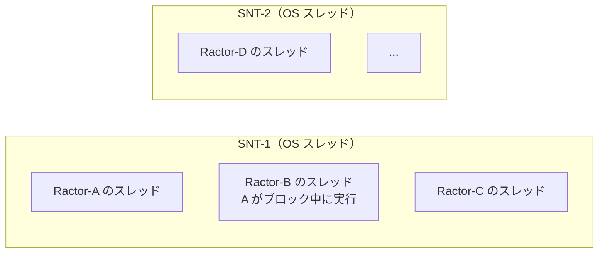
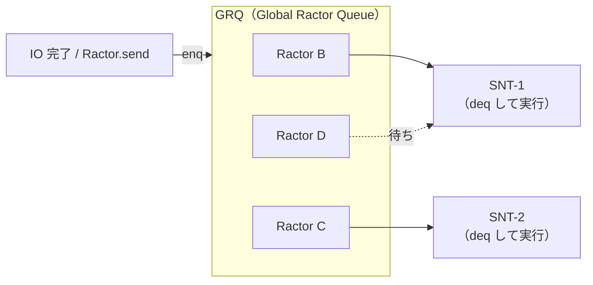
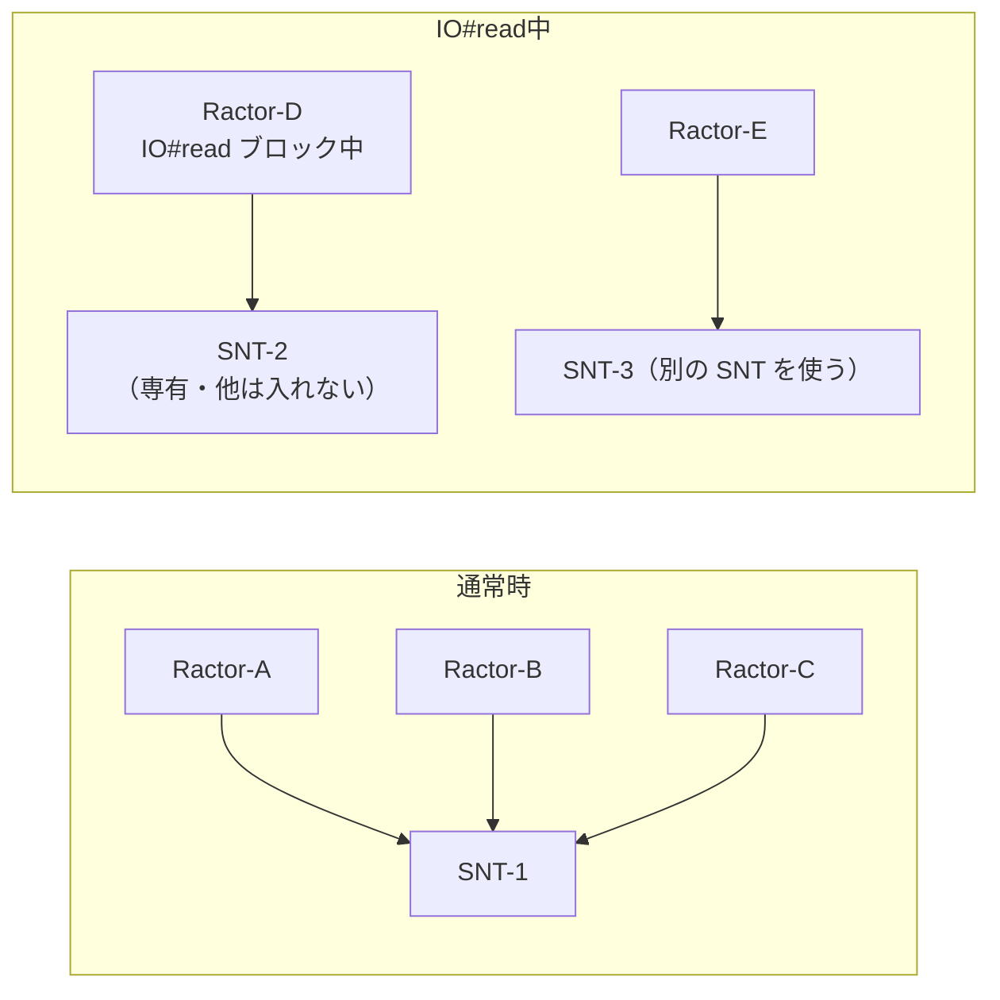
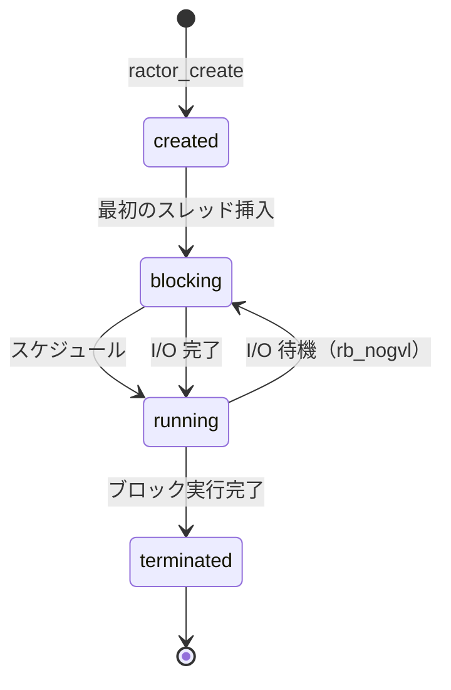

# Ractor 全体像（ruby/ruby master 17aeb89200）

ruby/ruby の Ractor が何者で、どう動くかを一枚に整理する。
biryani の実装を読む前提知識として、また発見を ruby/ruby の文脈に位置づけるための参照ページ。

## Ractor とは

Ractor（Ruby Actor）は Ruby 3.0 で導入された並行処理プリミティブ。
「オブジェクトの所有権分離」によってデータ競合を原則防ぎながら、OS スレッドの真の並列実行を可能にする。

Thread との最大の違い:
- **Thread**: 全スレッドが1つの GVL（Global VM Lock）を共有 → Ruby コードは同時実行できない
- **Ractor**: 各 Ractor が独自の GVL を持つ → 複数 Ractor が真に並列実行できる

## OS スレッドとのマッピング — M:N スレッドスケジューラ

Ruby のスレッドモデルは版によって変化してきた:

| 時期 | モデル | 説明 |
|------|--------|------|
| Ruby 1.8 以前 | M:1 | M Ruby スレッドを 1 OS スレッドで処理（グリーンスレッド） |
| Ruby 1.9〜3.2 | 1:1 | 1 Ruby スレッド = 1 OS スレッド |
| Ruby 3.3〜 | M:N | M Ruby スレッドを N OS スレッドで処理 |

Ruby 3.3 から導入された **M:N スケジューラ**（goroutine スケジューラに着想）では:
- **非 main Ractor**: M:N スケジューラがデフォルトで有効（`17aeb89200` では `RUBY_MN_THREADS=-1` で無効化できる）
- **main Ractor**: デフォルトは 1:1。`RUBY_MN_THREADS=1` で M:N を有効化（`=2` で main スレッド自身も M:N に乗る。`ce6f200972` で追加）
- N（OS スレッド数）は `RUBY_MAX_CPU` で指定。デフォルトは論理 CPU 数（`e98f95b4fd` 以前は **8** 固定）

（ソース: `doc/NEWS/NEWS-3.3.0.md:457`, [`thread_sched.c:1823-1836`](https://github.com/ruby/ruby/blob/17aeb89200f13a392c645102800b68b9d16b926b/thread_sched.c#L1823-L1836)）

### SNT（Shared Native Thread）

M:N モードで使われる共有 OS スレッド。



> "Ruby threads from different ractors can even run on the same SNT."
> — `doc/contributing/glossary.md`

Ruby スレッドはコンテキストスイッチのたびに SNT を乗り換えることができる。
ブロッキング I/O 発生時は epoll/kqueue（Linux: `USE_MN_THREADS=1` が epoll で有効化）が
完了を検知し、次の Ruby スレッドを SNT に載せる。

### GRQ（Global Ractor Queue）

M:N スケジューラが管理する「実行待ち Ractor の待ち行列」。
SNT は GRQ から Ractor を取り出して実行し、GRQ が空なら仕事が来るまで待機する。



Ractor が GRQ に入る（enq）タイミング:
- `IO#read` 完了（epoll/kqueue が通知）
- `Ractor.send` でメッセージが届いた
- タイムスライスで強制プリエンプト

SNT が GRQ を取り出す（deq）タイミング:
- 現在実行中の Ractor が IO ブロックや `Ractor.recv` で停止したとき
- 実行完了で次の仕事を探すとき

SNT の retire（`17aeb89200`）: GRQ が空＝「全 Ractor が IO 待ちか終了済み」の状態。
起こされても GRQ が空だったことが `SNT_IDLE_RETIRE`（デフォルト 3）回を超えて続くと、その SNT は自分で終了する（最後の 1 本は残す）。
`e98f95b4fd` 時点にあった `SNT_KEEP_SECONDS`（デフォルト 0 で無効）は `1da2eea37c` で削除され、この仕組みに置き換わった。

ソース: [`ractor_sched_deq`](https://github.com/ruby/ruby/blob/17aeb89200f13a392c645102800b68b9d16b926b/thread_sched.c#L1364)（`thread_sched.c:1364`）、[`ractor_sched_enq`](https://github.com/ruby/ruby/blob/17aeb89200f13a392c645102800b68b9d16b926b/thread_sched.c#L1302)（`thread_sched.c:1302`）

### dedicated SNT（専有ネイティブスレッド）

ブロッキング操作（`IO#read` 等）を実行中のスレッドは SNT を **専有（dedicated）** する。
他の Ruby スレッドはその SNT を使えない。



dedicated SNT になると [`native_thread_dedicated_inc`](https://github.com/ruby/ruby/blob/17aeb89200f13a392c645102800b68b9d16b926b/thread_sched.c#L1858)（`thread_sched.c:1858`）が呼ばれ、
スレッドは `rb_native_cond_wait(&th->nt->cond.readyq, ...)` で眠る。
I/O 完了時に `rb_native_cond_signal(&th->nt->cond.readyq)` で起こされる。

**biryani との関係**: `IO#read` が 47.9%（wall time）を占めるため、dedicated SNT の確保・解放が頻繁に発生する。FlameGraph の futex ~11% の主因。→ [findings/futex-mn-scheduler-dedicated-nt](../findings/futex-mn-scheduler-dedicated-nt.md)

### biryani への影響

biryani の `-c25 -m50` では 1,300 の非 main Ractor が起動する。
M:N モードではこれらは **最大 8 OS スレッド（+ ブロッキング操作用の追加スレッド）** を共有する。
「1,300 Ractors = 1,300 OS スレッド」ではない。

ただし FlameGraph では `thread_create_core` が 5〜10% 現れており、
実際に多くの OS スレッドが生成されていることを示している。ブロッキング I/O（`IO#read` 47.9%）
のたびに追加の OS スレッドが生成される可能性があり、要調査。

## ライフサイクル



ソース: [`ractor_status_set`](https://github.com/ruby/ruby/blob/17aeb89200f13a392c645102800b68b9d16b926b/ractor.c#L181)（`ractor.c:181`）、状態名は [`ractor_status_str`](https://github.com/ruby/ruby/blob/17aeb89200f13a392c645102800b68b9d16b926b/ractor.c#L169)（`ractor.c:169`）

- **created**: メモリ確保済み、まだ実行開始前
- **running**: Ruby コードを実行中
- **blocking**: ブロッキング I/O 等で待機中（`rb_nogvl` の外側）
- **terminated**: ブロック実行完了

## 内部構造体

### `rb_ractor_t`（[`ractor_core.h:98`](https://github.com/ruby/ruby/blob/17aeb89200f13a392c645102800b68b9d16b926b/ractor_core.h#L98)）

Ractor の本体。`rb_ractor_struct` の typedef。

```c
struct rb_ractor_struct {
    struct rb_ractor_pub  pub;      // Ruby オブジェクト表現・ID・フック
    struct rb_ractor_sync sync;     // ロック・キュー・Port（スレッド間共有部）

    struct {
        struct ccan_list_head set;  // このRactor内のスレッドリスト
        unsigned int cnt;
        unsigned int blocking_cnt;
        unsigned int sleeper;
        struct rb_thread_sched sched;
        rb_execution_context_t *running_ec;
        rb_thread_t *main;
        rb_thread_t *dying_th;      // M:N 終了処理中のスレッドを mark し続けるため
        bool terminating;
    } threads;

    VALUE name;
    VALUE loc;
    enum ractor_status status_;     // created/running/blocking/terminated

    struct ccan_list_node vmlr_node; // vm->ractor.set へのリンク

    st_table    *local_storage;     // Ractor ローカル変数
    VALUE        r_stdin;           // Ractor 固有の $stdin/$stdout/$stderr
    VALUE        r_stdout;
    VALUE        r_stderr;
    // ...
};
```

### `rb_ractor_pub`（[`vm_core.h:2439`](https://github.com/ruby/ruby/blob/17aeb89200f13a392c645102800b68b9d16b926b/vm_core.h#L2439)）

Ruby レベルから見える公開フィールド。

```c
struct rb_ractor_pub {
    VALUE        self;              // Ruby オブジェクトとしての自身
    rb_serial_t  id;                // Ractor#id の値（acc5cd03d9 で 64 bit 化）
    rb_hook_list_t hooks;           // TracePoint フック
    st_table     targeted_hooks;    // 17aeb89200 ではポインタではなく埋め込み
    unsigned int targeted_hooks_cnt;
};
```

### `rb_ractor_sync`（[`ractor_core.h:33`](https://github.com/ruby/ruby/blob/17aeb89200f13a392c645102800b68b9d16b926b/ractor_core.h#L33)）

スレッド間で共有されるすべての状態。ractor lock（`sync.lock`）で保護される。

```c
struct rb_ractor_sync {
    rb_nativethread_lock_t  lock;           // pthread_mutex：Ractor 操作全般を保護

    struct ractor_queue    *recv_queue;     // 全Portへの着信を受け取る共通キュー
    struct ccan_list_head   waiters;        // recv 待機中のスレッド（ractor_waiter のリスト）

    VALUE                   default_port_value;
    struct st_table        *ports;          // port_id → ractor_queue のハッシュ
    size_t                  next_port_id;

    struct ccan_list_head   off_queue_baskets; // どのキューにも載っていない送信中・受信中の basket

    struct ccan_list_head   monitors;       // join 待ちの監視 Ractor
    rb_ractor_t            *successor;      // 終了時に値を渡す先
};
```

### `ractor_basket`（[`ractor_sync.c:250`](https://github.com/ruby/ruby/blob/17aeb89200f13a392c645102800b68b9d16b926b/ractor_sync.c#L250)）

キューを流れるメッセージ1件。

```c
struct ractor_basket {
    VALUE     sender;               // 送信元
    st_data_t port_id;              // 宛先ポートID

    union {
        VALUE v;
        struct rb_ractor_courier *courier;  // copy/move はヒープ外の courier にシリアライズ
    } p;                            // ペイロード

    struct ccan_list_node node;     // キューへの侵入リストノード

    enum ractor_basket_type type : 8;  // none / ref / copy / move
    bool has_courier;
    bool exception;
};
// b5d839dbca で 80 → 48 bytes に縮小
```

### `ractor_queue`（[`ractor_sync.c:358`](https://github.com/ruby/ruby/blob/17aeb89200f13a392c645102800b68b9d16b926b/ractor_sync.c#L358)）

メッセージの連結リストキュー。`recv_queue`（共通着信）と per-port キューの両方に使われる。

```c
struct ractor_queue {
    struct ccan_list_head set;      // ractor_basket の侵入リスト
    bool closed;
    bool alive;                     // Ractor::Port がまだ到達可能か
};
```

### `ractor_waiter`（[`ractor_core.h:207`](https://github.com/ruby/ruby/blob/17aeb89200f13a392c645102800b68b9d16b926b/ractor_core.h#L207)）

`ractor_wait` 中のスレッドを表す。`sync.waiters` リストに積まれる。

```c
struct ractor_waiter {
    enum ractor_wakeup_status wakeup_status;  // wakeup_none / wakeup_by_send / wakeup_by_interrupt
    rb_thread_t            *th;
    struct ccan_list_node   node;
    rb_atomic_t             event_serial;
    const rb_hrtime_t      *end;        // 受信タイムアウトの絶対時刻（なければ NULL）
};
```

### 構造体の関係図

```
rb_ractor_t
├── pub (rb_ractor_pub)
│   ├── self (VALUE)       ← Ruby オブジェクト
│   └── id (rb_serial_t)   ← Ractor#id
├── sync (rb_ractor_sync)
│   ├── lock               ← pthread_mutex
│   ├── recv_queue ────────→ ractor_queue
│   │                           └── [basket] → [basket] → ...
│   ├── waiters ───────────→ [ractor_waiter] → [ractor_waiter] → ...
│   └── ports (st_table)
│       └── port_id → ractor_queue
│                         └── [basket] → ...
├── threads
│   ├── set ───────────────→ [rb_thread_t] → ...
│   └── running_ec         ← 現在実行中の EC
└── status_                ← created/running/blocking/terminated
```

## オブジェクトの扱い — 共有モデル

Ractor 間で渡せるオブジェクトは3種類に分類される:

| 方法 | 動作 | 用途 |
|------|------|------|
| **copy**（デフォルト） | 深コピー（`17aeb89200` ではヒープ外の courier にシリアライズして受信側で復元。Marshal へのフォールバックは `dea2cdac07` で削除） | 通常のオブジェクト |
| **move**（`move: true`） | 所有権を移す。元 Ractor はアクセス不可 | 大きなオブジェクトのゼロコピー転送 |
| **shareable** | 参照をそのまま渡す | 読み取り専用データ |

Ractor-shareable なオブジェクト（参照共有可能）:
- Integer, Symbol, true/false/nil（即値）
- frozen なオブジェクト（ただし frozen な内部オブジェクトも全て shareable であること）
- `Ractor.make_shareable(obj)` で明示的に shareable 化
- `Ractor.shareable_proc { ... }` でブロックを shareable 化（biryani がハンドラ定義に使用）

## エラー体系

| 例外 | 発生条件 |
|------|---------|
| `Ractor::ClosedError` | 閉じたポートへの送受信 |
| `Ractor::RemoteError` | Ractor 内の未捕捉例外（`join`/`value` で再送出） |
| `Ractor::MovedError` | move 済みオブジェクトへのアクセス |
| `Ractor::IsolationError` | 非 shareable オブジェクトの共有試み |
| `Ractor::UnsafeError` | Ractor 安全でない操作 |

`ClosedError` は `StopIteration` を継承しているため、ループ内で `break` として扱われる。

## パフォーマンス上の特性

| 特性 | 内容 |
|------|------|
| 生成コスト | Ruby スレッド生成 + SNT への登録（M:N 下では OS スレッド生成より軽い） |
| wall time | biryani 実測で `Ractor.new` 0.0%（I/O 待機に比べて無視できる） |
| CPU 時間 | perf 実測で ~5-10%（`thread_create_core` + `nt_alloc_stack`） ※要因は調査中 |
| 同期 | 1 send = `rb_native_cond_signal`（per-SNT）。`90e729c9bc` でスケジューラが POSIX と Windows で共通化され、Win32 専用の `pthread_cond_broadcast` パスはなくなった |
| OS スレッド数 | M:N モード、N = 論理 CPU 数（`e98f95b4fd` で変更、旧デフォルト 8）+ ブロッキング操作用追加スレッド。余った SNT は retire する（`43793ca21a`） |

## 関連ページ

- [source-reading-guide](../source-reading-guide.md) — ソースコード読み方ガイド
- [internals/biryani-ractor-architecture](biryani-ractor-architecture.md) — biryani がこれをどう使うか
- [internals/ractor-port-implementation](ractor-port-implementation.md) — Port と recv_queue の C 実装詳細
- [internals/ractor-sync-wakeup](ractor-sync-wakeup.md) — wakeup メカニズム（Linux vs Win32 の実装分岐）
- [findings/rperf-wall-vs-perf-cpu](../findings/rperf-wall-vs-perf-cpu.md) — 実測データ（wall time vs CPU time）
