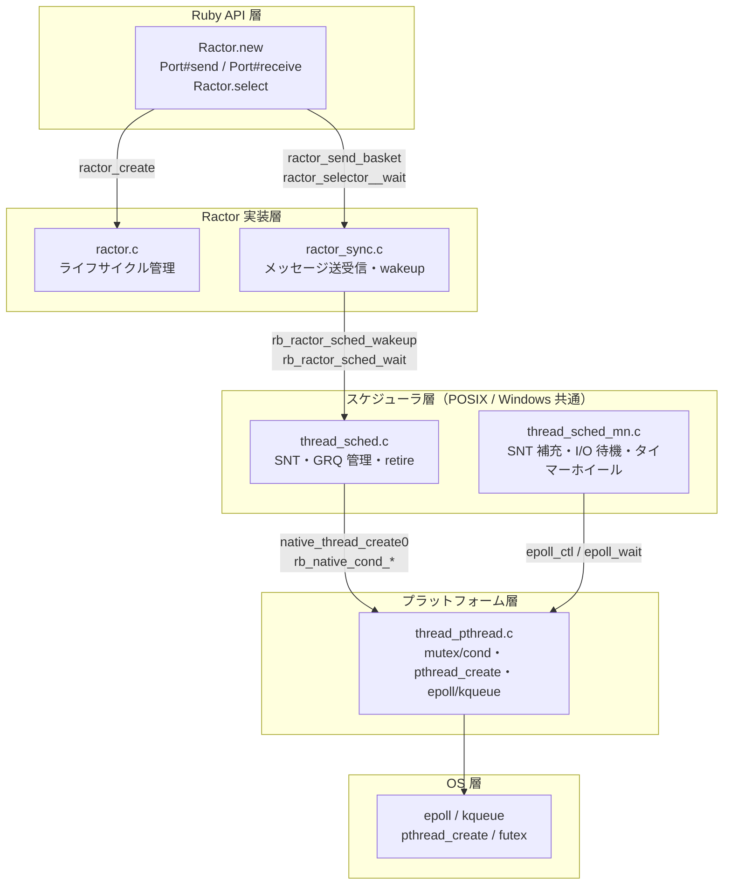
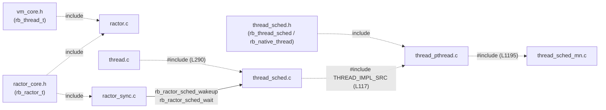

# ruby/ruby Ractor ソースコード読み方ガイド

wiki で出てきたトピックに沿って、ソースコードをどの順で読めばよいかをまとめる。
`raw/ruby-src/` は commit `17aeb89200`（master、2026-10-10）を指すサブモジュールなので、ここに書いた行番号でそのままジャンプできる。

> 2026-10-11 に `e98f95b4fd` → `17aeb89200` へ更新した。M:N スケジューラは `thread_pthread.c` / `thread_pthread_mn.c` から
> `thread_sched.c` / `thread_sched_mn.c` に移っている。変更点の一覧: [internals/upstream-scheduler-changes-2026](internals/upstream-scheduler-changes-2026.md)

## 全体像

### レイヤー構成

Ruby API から OS まで 4 層に分かれる。



### ファイル依存関係

ヘッダの include（点線）と関数呼び出し（実線）の 2 種類がある。
`thread_sched.c` / `thread_pthread.c` / `thread_sched_mn.c` は、どれも単独ではコンパイルされない。
`thread.c` を起点に入れ子で include される（`thread.c` → `thread_sched.c` → `thread_pthread.c` → `thread_sched_mn.c`）。



---

## 読む順番

```
1. ractor_core.h          ← 構造体の地図
2. ractor.c               ← Ractor のライフサイクル
3. ractor_sync.c          ← send/recv/wakeup の実装
4. thread_sched.c         ← スケジューラ本体（SNT 管理・GRQ・retire）
5. thread_sched_mn.c      ← SNT 補充・I/O 待機・タイマーホイール
6. thread_pthread.c       ← pthread_create など OS との境界（必要なときだけ）
```

---

## ステップ 1：データ構造を把握する

まず「何があるか」を頭に入れる。実行の流れを追う前に構造体を眺めておく。

**[`ractor_core.h`](https://github.com/ruby/ruby/blob/17aeb89200f13a392c645102800b68b9d16b926b/ractor_core.h)**

| 構造体 | 内容 | wiki |
|--------|------|------|
| [`rb_ractor_t`（:98）](https://github.com/ruby/ruby/blob/17aeb89200f13a392c645102800b68b9d16b926b/ractor_core.h#L98) | Ractor 本体 | [ractor-overview](internals/ractor-overview.md) |
| [`rb_ractor_sync`（:33）](https://github.com/ruby/ruby/blob/17aeb89200f13a392c645102800b68b9d16b926b/ractor_core.h#L33) | 同期まわり・キュー・Port | [ractor-port-implementation](internals/ractor-port-implementation.md) |
| [`ractor_basket`（ractor_sync.c:250）](https://github.com/ruby/ruby/blob/17aeb89200f13a392c645102800b68b9d16b926b/ractor_sync.c#L250) | メッセージ 1 件 | [ractor-port-implementation](internals/ractor-port-implementation.md) |

**[`thread_sched.h`](https://github.com/ruby/ruby/blob/17aeb89200f13a392c645102800b68b9d16b926b/thread_sched.h)** — `rb_thread_sched` / `rb_native_thread` などスケジューラの構造体（`17aeb89200` で `thread_pthread.h` から分離）

[internals/ractor-overview](internals/ractor-overview.md) の「内部構造体」セクションに ASCII 図があるので、並べて読むと理解しやすい。

---

## ステップ 2：Ractor のライフサイクルを追う

**[`ractor.c`](https://github.com/ruby/ruby/blob/17aeb89200f13a392c645102800b68b9d16b926b/ractor.c)**

| 読むべき関数 | 内容 | wiki |
|------------|------|------|
| [`ractor_status_set`（:181）](https://github.com/ruby/ruby/blob/17aeb89200f13a392c645102800b68b9d16b926b/ractor.c#L181) | `created → running → blocking → terminated` の状態遷移 | [ractor-overview](internals/ractor-overview.md) |
| `ractor_create`（近辺） | `Ractor.new` の実装。スレッド生成への入り口 | [biryani-ractor-architecture](internals/biryani-ractor-architecture.md) |

ファイルが長いので、`ractor_status_set` を grep して前後を読めば十分。

---

## ステップ 3：メッセージ送受信と wakeup

**[`ractor_sync.c`](https://github.com/ruby/ruby/blob/17aeb89200f13a392c645102800b68b9d16b926b/ractor_sync.c)**

| 読むべき関数 | 内容 | wiki |
|------------|------|------|
| [`ractor_send_basket`（:1595）](https://github.com/ruby/ruby/blob/17aeb89200f13a392c645102800b68b9d16b926b/ractor_sync.c#L1595-L1629) | `Port#send` の実装。受信側のロックを持ったまま enqueue → `ractor_wakeup_all_locked` を呼ぶ | [ractor-port-implementation](internals/ractor-port-implementation.md) |
| [`ractor_wakeup_all_locked`（:1318）](https://github.com/ruby/ruby/blob/17aeb89200f13a392c645102800b68b9d16b926b/ractor_sync.c#L1318-L1343) | waiter を順に起こすループ（`4133daa130` でロックを取るラッパーと分離） | [ractor-sync-wakeup](internals/ractor-sync-wakeup.md) |
| [`ractor_selector__wait`（:1849）](https://github.com/ruby/ruby/blob/17aeb89200f13a392c645102800b68b9d16b926b/ractor_sync.c#L1849-L1874) | `Ractor.select` が全ポートをポーリングするループ。タイムアウト用の `end` を取る | [ractor-select-implementation](internals/ractor-select-implementation.md) |

[internals/ractor-sync-wakeup](internals/ractor-sync-wakeup.md) の「Linux の実際のコールチェーン」を手元に置いて読むと、どの行がどのステップか追いやすい（行番号は旧コミット時点）。

---

## ステップ 4：スケジューラの実装（核心）

**[`thread_sched.c`](https://github.com/ruby/ruby/blob/17aeb89200f13a392c645102800b68b9d16b926b/thread_sched.c)**

| 読むべき箇所 | 内容 | wiki |
|------------|------|------|
| [`:983`（`thread_sched_to_waiting_common`）](https://github.com/ruby/ruby/blob/17aeb89200f13a392c645102800b68b9d16b926b/thread_sched.c#L983-L995) | ブロッキング操作の前に `native_thread_dedicated_inc` を呼ぶ | [nonblocking-io-mn-scheduler-path](internals/nonblocking-io-mn-scheduler-path.md) |
| [`:1302`（`ractor_sched_enq`）](https://github.com/ruby/ruby/blob/17aeb89200f13a392c645102800b68b9d16b926b/thread_sched.c#L1302-L1342) | Ractor を GRQ に入れる | [ractor-mn-snt-lifecycle](internals/ractor-mn-snt-lifecycle.md) |
| [`:1350-1361`](https://github.com/ruby/ruby/blob/17aeb89200f13a392c645102800b68b9d16b926b/thread_sched.c#L1350-L1361) | `SNT_IDLE_RETIRE`・`SNT_KEEP_MINIMUM` の定義 | [upstream-scheduler-changes-2026](internals/upstream-scheduler-changes-2026.md) |
| [`:1364`（`ractor_sched_deq`）](https://github.com/ruby/ruby/blob/17aeb89200f13a392c645102800b68b9d16b926b/thread_sched.c#L1364-L1410) | SNT が GRQ から Ractor を取り出すループ。空振りが続いたときの retire 分岐もここ | [mn-snt-pool-growth-shrink](internals/mn-snt-pool-growth-shrink.md) |
| [`:1418`（`rb_ractor_sched_wait`）](https://github.com/ruby/ruby/blob/17aeb89200f13a392c645102800b68b9d16b926b/thread_sched.c#L1418-L1488) | M:N スケジューラに入って眠る | [ractor-sync-wakeup](internals/ractor-sync-wakeup.md) |
| [`:1491`（`rb_ractor_sched_wakeup`）](https://github.com/ruby/ruby/blob/17aeb89200f13a392c645102800b68b9d16b926b/thread_sched.c#L1491-L1519) | wakeup の実装（POSIX / Windows 共通） | [ractor-sync-wakeup](internals/ractor-sync-wakeup.md) |
| [`:1838`（`RUBY_MAX_CPU`）](https://github.com/ruby/ruby/blob/17aeb89200f13a392c645102800b68b9d16b926b/thread_sched.c#L1838-L1848) | `max_cpu` の設定箇所 | [contributions/default-max-cpu-cpu-count](contributions/default-max-cpu-cpu-count.md) |
| [`:1858`（`native_thread_dedicated_inc`）](https://github.com/ruby/ruby/blob/17aeb89200f13a392c645102800b68b9d16b926b/thread_sched.c#L1858-L1881) | dedicated 化で `snt_cnt` を減らす | [ractor-mn-snt-lifecycle](internals/ractor-mn-snt-lifecycle.md) |
| [`:1884`（`native_thread_dedicated_dec`）](https://github.com/ruby/ruby/blob/17aeb89200f13a392c645102800b68b9d16b926b/thread_sched.c#L1884-L1910) | dedicated 解除。プールが満杯なら nt を retire させる | [nonblocking-io-mn-scheduler-path](internals/nonblocking-io-mn-scheduler-path.md) |
| [`:1978`（`nt_start`）](https://github.com/ruby/ruby/blob/17aeb89200f13a392c645102800b68b9d16b926b/thread_sched.c#L1978-L2032) / [`:2062`（`nt_shared_loop`）](https://github.com/ruby/ruby/blob/17aeb89200f13a392c645102800b68b9d16b926b/thread_sched.c#L2062-L2122) | SNT のメインループ。retire した nt は `native_thread_destroy_self` で自分を解放する | [contributions/snt-keep-seconds-enable](contributions/snt-keep-seconds-enable.md) |

**[`thread_sched_mn.c`](https://github.com/ruby/ruby/blob/17aeb89200f13a392c645102800b68b9d16b926b/thread_sched_mn.c)**

| 読むべき箇所 | 内容 | wiki |
|------------|------|------|
| [`:106`（`timer_wheel_insert`）](https://github.com/ruby/ruby/blob/17aeb89200f13a392c645102800b68b9d16b926b/thread_sched_mn.c#L106-L135) | タイムアウト付き待ちを入れる階層タイマーホイール（O(1)） | [timer-waiting-list-sort](internals/timer-waiting-list-sort.md) |
| [`:536`（`thread_sched_wait_events`）](https://github.com/ruby/ruby/blob/17aeb89200f13a392c645102800b68b9d16b926b/thread_sched_mn.c#L536-L616) | ノンブロッキング I/O が EAGAIN を返したときの epoll 待ちパス | [nonblocking-io-mn-scheduler-path](internals/nonblocking-io-mn-scheduler-path.md) |
| [`:932`（`native_thread_check_and_create_shared`）](https://github.com/ruby/ruby/blob/17aeb89200f13a392c645102800b68b9d16b926b/thread_sched_mn.c#L932-L989) | SNT 補充ロジック | [ractor-mn-snt-lifecycle](internals/ractor-mn-snt-lifecycle.md) |
| [`:948-950`](https://github.com/ruby/ruby/blob/17aeb89200f13a392c645102800b68b9d16b926b/thread_sched_mn.c#L948-L950) | 補充条件（`snt_cnt < max_cpu`、CAS ループ） | [mn-snt-pool-growth-shrink](internals/mn-snt-pool-growth-shrink.md) |
| [`:1464`（`timer_thread_register_waiting`）](https://github.com/ruby/ruby/blob/17aeb89200f13a392c645102800b68b9d16b926b/thread_sched_mn.c#L1464-L1578) | I/O / タイムアウト待機の登録 | [timer-waiting-list-sort](internals/timer-waiting-list-sort.md) |

**[`thread_pthread.c`](https://github.com/ruby/ruby/blob/17aeb89200f13a392c645102800b68b9d16b926b/thread_pthread.c)**（プラットフォーム層）

| 読むべき箇所 | 内容 | wiki |
|------------|------|------|
| [`:507`（`native_thread_destroy_self`）](https://github.com/ruby/ruby/blob/17aeb89200f13a392c645102800b68b9d16b926b/thread_pthread.c#L507-L515) | retire する SNT が自分の nt を解放する | [upstream-scheduler-changes-2026](internals/upstream-scheduler-changes-2026.md) |
| [`:791`（`native_thread_create0`）](https://github.com/ruby/ruby/blob/17aeb89200f13a392c645102800b68b9d16b926b/thread_pthread.c#L791-L821) | `pthread_create`（FlameGraph の `thread_create_core`） | [ractor-mn-snt-lifecycle](internals/ractor-mn-snt-lifecycle.md) |
| [`:911`（`native_thread_default_max_cpu`）](https://github.com/ruby/ruby/blob/17aeb89200f13a392c645102800b68b9d16b926b/thread_pthread.c#L911) | `sysconf(_SC_NPROCESSORS_ONLN)` による `max_cpu` のデフォルト値 | [contributions/default-max-cpu-cpu-count](contributions/default-max-cpu-cpu-count.md) |

---

## 実用的なコツ

- **grep を起点にする**: 関数名（`ractor_wakeup_all`, `native_thread_dedicated_inc` 等）で grep して前後 30 行を読む方が、ファイル全体を読むより速い
- **wiki の行番号**: このガイドと `17aeb89200` の permalink は最新コミットの行番号である。冒頭に「`e98f95b4fd` 時点」と注記したページの `:行番号` は旧コミットのもので、`raw/ruby-src` とは一致しない
- **プラットフォームの切り替え**: `17aeb89200` ではスケジューラが共通化されたため、`#ifdef RUBY_THREAD_PTHREAD_H` で読み飛ばす場面は減った。プラットフォーム差分は `thread_pthread.c` / `thread_win32.c` にまとまっている

---

## 用語集

ソースを読むときに頻出する略語・概念の一覧。

| 用語 | 正式名称 / 説明 |
|------|----------------|
| **SNT** | Shared Native Thread。M:N スケジューラが複数の Ruby スレッドで共有する OS スレッド。`vm->ractor.sched.snt_cnt` で管理。 |
| **DNT** | Dedicated Native Thread。ブロッキング I/O（`IO#read` 等）の間、1 つの Ruby スレッドが専有する OS スレッド。`vm->ractor.sched.dnt_cnt` で管理（デバッグログ用）。 |
| **GRQ** | Global Ractor Queue。実行可能な Ractor を溜めるキュー。SNT が `ractor_sched_deq` でここから Ractor を取り出す。 |
| **M:N スケジューラ** | M 個の Ruby スレッドを N 個の OS スレッド（SNT）で処理する Ruby 3.3+ の実行モデル。非 main Ractor に適用。`RUBY_MN_THREADS=-1` で無効化、`=1` で main Ractor にも適用、`=2` で main スレッドにも適用。 |
| **`dedicated_inc` / `dedicated_dec`** | `native_thread_dedicated_inc` / `native_thread_dedicated_dec`。I/O ブロックの開始・終了時に SNT を dedicated にしたり戻したりし、`snt_cnt` を増減させる。戻るときにプールが満杯なら retire する。 |
| **`max_cpu`** | `vm->ractor.sched.max_cpu`。SNT プールの上限。`RUBY_MAX_CPU` 環境変数で指定する。デフォルトは論理 CPU 数（`e98f95b4fd` 以降）。 |
| **retire** | 余った SNT が自分で終了すること。GRQ の空振りが `SNT_IDLE_RETIRE`（3）回を超えたとき、または `dedicated_dec` の時点でプールが満杯のときに起きる（`43793ca21a`）。 |
| **`SNT_KEEP_MINIMUM`** | retire しても残す SNT の最小数（`MINIMUM_SNT > 1 ? MINIMUM_SNT : 1`）。最後の 1 本は残る。 |
| **`SNT_KEEP_SECONDS`** | （削除済み、`1da2eea37c`）旧コードにあったアイドル SNT のタイムアウト秒数。デフォルト 0 で無効だった。 |
| **`MINIMUM_SNT`** | SNT プールの最低維持数。現在 `0`（コメントには "for debug"）。 |
| **タイマーホイール** | タイムアウト付き待ちを管理する階層タイマーホイール（4 段 × 64 スロット）。旧 `timer_th.waiting` の O(n) ソート挿入を置き換えた（`168eada435`）。 |
| **`EPOLLONESHOT`** | M:N の I/O 待ちで、fd の epoll 登録を残したまま再アームする方式（`ce15950f56`）。 |
| **`readyq`** | per-NT の条件変数（`nt->readyq`）。`rb_ractor_sched_wakeup` などが `signal` を発行する。 |

---

## 関連ページ

- [internals/upstream-scheduler-changes-2026](internals/upstream-scheduler-changes-2026.md) — `e98f95b4fd` → `17aeb89200` の上流変更まとめ
- [internals/ractor-overview](internals/ractor-overview.md) — Ractor 全体像・構造体の解説
- [internals/biryani-ractor-architecture](internals/biryani-ractor-architecture.md) — biryani の Ractor 設計（Connection / recv_loop / Stream）
- [internals/ractor-port-implementation](internals/ractor-port-implementation.md) — `Ractor::Port` の C 実装・recv_queue 二段キュー
- [internals/ractor-sync-wakeup](internals/ractor-sync-wakeup.md) — wakeup メカニズム
- [internals/ractor-select-implementation](internals/ractor-select-implementation.md) — `Ractor.select` の C 実装
- [internals/ractor-mn-snt-lifecycle](internals/ractor-mn-snt-lifecycle.md) — SNT ライフサイクルと補充ロジック
- [internals/mn-snt-pool-growth-shrink](internals/mn-snt-pool-growth-shrink.md) — `max_cpu` と SNT プールの縮小
- [internals/nonblocking-io-mn-scheduler-path](internals/nonblocking-io-mn-scheduler-path.md) — ノンブロッキング I/O と epoll パス
- [internals/ractor-local-gc-status](internals/ractor-local-gc-status.md) — Ractor-local GC（Ruby 4.0.2 時点。per-Ractor GC が入る前の記述）
- [internals/timer-waiting-list-sort](internals/timer-waiting-list-sort.md) — `timer_th.waiting` の O(n) ソート挿入 TODO（上流で解決済み）
